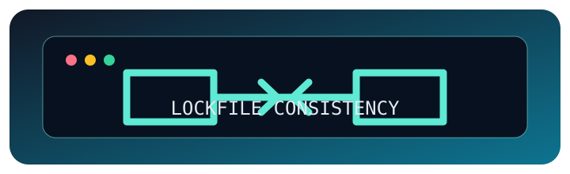

<p align="center"></p>
<p align="center"></p>
<p align="center">   </p>
<p align="center"></p>

## 🧭 Overview
NPM Lock Audit compares dependency groups in `package.json` with the root package metadata in `package-lock.json`. It is read-only and works entirely with local files.

## ✨ Features
- 📦 Compare dependencies, devDependencies, and optionalDependencies
- 🔍 Detect missing or mismatched root lockfile declarations
- ⚠️ Explain when a legacy lockfile cannot be compared fully
- 🔒 No package installation and no registry access

## 🖥️ Demo
No hosted demo is provided. Run the tool locally using the quick-start command.

## 🚀 Quick Start
Requires Node.js 18 or newer.

```bash
npm start -- ./package.json ./package-lock.json
```

Run checks with `npm test`.

## 🧰 Tech Stack
- Node.js built-in modules
- JSON parsing and Node.js built-in test runner

## 🗂️ Folder Structure
```text
.
├── .github/workflows/ci.yml
├── assets/mark.svg
├── tests/audit.test.js
├── main.js
├── package.json
└── README.md
```

## 🗺️ Roadmap
- [ ] Add support for additional lockfile edge cases
- [ ] Improve machine-readable reports
- [ ] Keep the tool registry-independent

## 🤝 Contributing
Issues and focused pull requests are welcome. Add regression tests when changing comparison behavior.

## 📄 License
MIT License. See [LICENSE](LICENSE).
<p align="center"></p>
